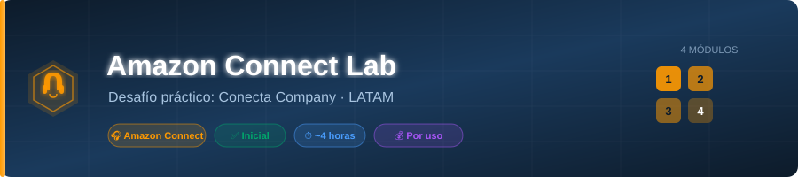
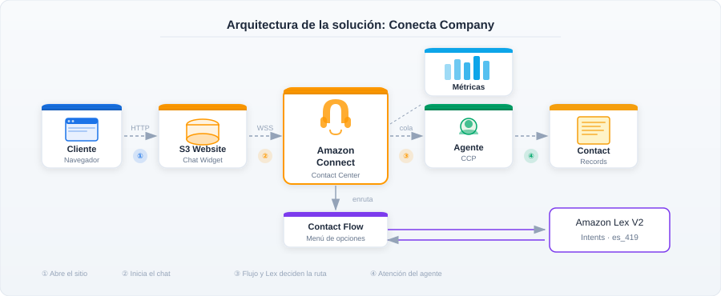
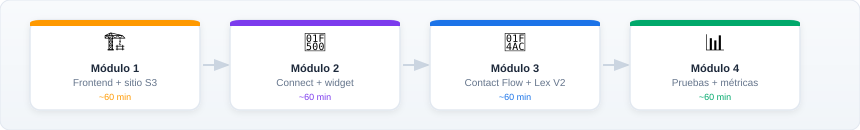

<div align="center">
  
</div>

<div align="center">

[](./LICENSE)
[](https://aws.amazon.com/connect/)
[](#-requisitos-previos)
[](#-módulos-del-desafío)

</div>

> Laboratorio práctico para aprender Amazon Connect construyendo una solución real de atención por chat.

**Edición LATAM en español latinoamericano**, basada en el laboratorio brasileño [GabrielFMarinho/aws-connect-challenge](https://github.com/GabrielFMarinho/aws-connect-challenge) (origen privado), revisión `13baaf1e20627eedaf9754fae9e9ef0bb7da41c7`. Conserva la estructura, los cuatro módulos, la arquitectura, los ejercicios y la duración aproximada de cuatro horas. Se mantienen la [licencia MIT y el copyright originales](./LICENSE). Consulta las [notas de adaptación y verificación](./ADAPTACION-LATAM.md).

---

## 🏢 Escenario

**Conecta Company** es una empresa en crecimiento que necesita implementar un canal de atención al cliente por chat en su sitio web. Te contrataron para construir esta solución desde cero con Amazon Connect.

Al terminar el desafío, habrás entregado un sistema funcional donde los clientes acceden a un sitio, inician una conversación por chat, recorren un menú de opciones y reciben atención de un agente.

## 🎯 Qué vas a construir

<div align="center">
  
</div>

```text
Cliente → Sitio web (S3) → Chat Widget → Amazon Connect → Contact Flow ↔ Amazon Lex V2
                                                            ↓
                                                       Agente (CCP)
```

| Componente | Qué es | Documentación |
|---|---|---|
| **Amazon Connect** | Plataforma de centro de contacto en la nube | [Descripción general](https://docs.aws.amazon.com/connect/latest/adminguide/what-is-amazon-connect.html) |
| **Amazon Lex V2** | Bot de comprensión del lenguaje natural que identifica intenciones y permite recorrer el menú | [Descripción general](https://docs.aws.amazon.com/lexv2/latest/dg/what-is.html) |
| **Contact Flow** | Flujo de atención que utiliza intents de Lex para el enrutamiento | [Crear flujos](https://docs.aws.amazon.com/connect/latest/adminguide/connect-contact-flows.html) |
| **Chat Widget** | Botón de chat integrado en el sitio | [Agregar chat](https://docs.aws.amazon.com/connect/latest/adminguide/add-chat-to-website.html) |
| **S3 Website** | Sitio estático que aloja el widget | [Alojamiento estático](https://docs.aws.amazon.com/AmazonS3/latest/userguide/WebsiteHosting.html) |
| **CCP** | Panel del agente para recibir chats | [Contact Control Panel](https://docs.aws.amazon.com/connect/latest/adminguide/amazon-connect-contact-control-panel.html) |

## 📦 Módulos del desafío

<div align="center">
  
</div>

El desafío se divide en **4 módulos progresivos**. Cada uno entrega una parte funcional de la solución.

| Módulo | Tema | Duración |
|---|---|---|
| [Módulo 1](./modulos/modulo-01/README.md) | Frontend + sitio S3 | ~60 min |
| [Módulo 2](./modulos/modulo-02/README.md) | Instancia Amazon Connect + widget | ~60 min |
| [Módulo 3](./modulos/modulo-03/README.md) | Contact Flow con Amazon Lex V2 | ~60 min |
| [Módulo 4](./modulos/modulo-04/README.md) | Pruebas, métricas y entrega | ~60 min |

**Tiempo total estimado: ~4 horas.**

## ✅ Requisitos previos

Antes de comenzar, confirma:

- [ ] Cuenta AWS activa con acceso a Amazon Connect, Lex V2 y S3; revisa el plan y los créditos disponibles
- [ ] Acceso a AWS Console y permisos para crear los recursos del laboratorio
- [ ] Navegador moderno (Chrome o Firefox)
- [ ] Editor de texto (VS Code, Notepad++ o similar)
- [ ] ~4 horas disponibles

No necesitas experiencia previa con Amazon Connect. Los nombres de las opciones de la consola se mantienen en inglés para facilitar su ubicación. Se recomienda `us-east-1` para los recursos del laboratorio.

## 💰 Costo estimado

**No se garantiza costo cero.** Revisa el modelo de tu instancia, la región, la elegibilidad y el saldo de créditos antes de crear recursos. Referencias consultadas el **8 de noviembre de 2026**:

| Servicio | Uso | Qué revisar |
|---|---|---|
| Amazon Connect | Mensajes del cliente, bot y agente | Connect Customer publica **USD 0,010 por mensaje enviado o recibido**. Customer Basic tiene tarifas propias: consulta el [detalle de precios](https://aws.amazon.com/products/connect/customer/pricing/appendix/). |
| Amazon Lex V2 | Reconocimiento de intents y pruebas | Las solicitudes originadas en **Connect Customer** están incluidas según la nota 6 del [detalle de precios](https://aws.amazon.com/products/connect/customer/pricing/appendix/). En Customer Basic o pruebas independientes del bot, comprueba los cargos aplicables de Lex. |
| Amazon S3 | Archivos del sitio y transcripciones, si se configuran | Almacenamiento, solicitudes y transferencia según uso y región: [precios de S3](https://aws.amazon.com/s3/pricing/). |
| CloudWatch | Logs, si los habilitas | Ingesta, almacenamiento y consultas según uso: [precios de CloudWatch](https://aws.amazon.com/cloudwatch/pricing/). |

**Ejemplo ilustrativo, antes de créditos e impuestos:** 100 mensajes facturables en Connect Customer × USD 0,010 = **USD 1,00 solo por el canal de chat**. No es un costo total garantizado. Cuenta los mensajes del bot que correspondan y agrega S3, logs y otros servicios utilizados. Fuente: [precios de Connect Customer](https://aws.amazon.com/products/connect/customer/pricing/).

Para solicitudes de texto de Lex facturadas por separado, el ejemplo oficial de solicitud/respuesta usa USD 0,00075 por solicitud; 100 solicitudes serían USD 0,075. Confirma la tarifa aplicable y evita contar dos veces solicitudes incluidas en Connect Customer. Fuente: [precios de Lex](https://aws.amazon.com/lex/pricing/).

### Cómo cobra AWS: revisa esto antes de comenzar

AWS cobra por uso. La cantidad de mensajes, solicitudes, datos almacenados y recursos adicionales determina el costo. No necesitas contratar números telefónicos ni activar canales adicionales para este laboratorio de chat.

El Free Tier depende de la fecha de creación de la cuenta y del plan. La documentación actual describe créditos para nuevas cuentas y un plan gratuito de hasta seis meses, con restricciones de servicios; las cuentas anteriores pueden tener beneficios distintos. **No supongas que todas las cuentas tienen 12 meses gratuitos ni que Connect está disponible en cualquier plan.** Verifica tu situación en Billing antes de continuar. Fuente: [AWS Free Tier](https://docs.aws.amazon.com/awsaccountbilling/latest/aboutv2/free-tier.html).

Buenas prácticas:

- Realiza las pruebas necesarias y controla el consumo en [Cost Explorer](https://console.aws.amazon.com/cost-management/home).
- Configura alertas en [AWS Budgets](https://console.aws.amazon.com/billing/home#/budgets); una alerta no detiene automáticamente el consumo.
- Conserva el sitio hasta la evaluación acordada con el instructor y luego elimina los recursos siguiendo el [módulo 4](./modulos/modulo-04/README.md).
- No guardes datos personales reales ni credenciales en archivos públicos, chats o evidencias.

Comprender los costos es parte de la formación en la nube: saber qué genera cargos es tan importante como construir la solución.

## 📁 Estructura del repositorio

Se conservan los nombres de las carpetas para facilitar la comparación con la edición brasileña.

```text
aws-connect-challenge-latam/
├── README.md                    ← Estás aquí
├── modulos/
│   ├── modulo-01/               ← Frontend + sitio S3
│   ├── modulo-02/               ← Instancia Amazon Connect + widget
│   ├── modulo-03/               ← Contact Flow con Amazon Lex V2
│   └── modulo-04/               ← Pruebas, métricas y entrega
├── exemplos/
│   └── frontend/                ← Código de ejemplo del sitio
├── assets/                      ← Diagramas y banner
├── templates/
│   ├── checklist.md             ← Lista de validación
│   └── entrega.md               ← Plantilla de entrega
├── troubleshooting.md           ← Solución de problemas
├── ADAPTACION-LATAM.md           ← Origen, ajustes y verificación
└── LICENSE                      ← Licencia MIT original
```

## 🚀 Cómo comenzar

1. Lee este README completo.
2. Abre el [módulo 1](./modulos/modulo-01/README.md).
3. Sigue los pasos en orden.
4. No omitas módulos: cada uno depende del anterior.

## 📋 Entregables

1. **URL pública** del sitio S3.
2. **Evidencias del bot Lex V2**, sus intents y una prueba de reconocimiento.
3. **Capturas de dos conversaciones** por rutas diferentes.
4. **Captura de las métricas históricas**.
5. **Captura de Contact Search** con tus contactos.
6. **Video de demostración** del chat completo (opcional, recomendado, como en el módulo 4 y la plantilla originales).

Usa la [plantilla de entrega](./templates/entrega.md) para organizarlo todo.

## 📚 Documentación AWS: referencia rápida

Cada módulo incluye sus propias referencias. Estos son los enlaces principales.

### Amazon Connect

| Tema | Enlace |
|---|---|
| Qué es Amazon Connect | [Descripción general](https://docs.aws.amazon.com/connect/latest/adminguide/what-is-amazon-connect.html) |
| Primeros pasos | [Guía de inicio](https://docs.aws.amazon.com/connect/latest/adminguide/amazon-connect-get-started.html) |
| Crear una instancia | [Instancias](https://docs.aws.amazon.com/connect/latest/adminguide/amazon-connect-instances.html) |
| Administración de identidades | [Identity management](https://docs.aws.amazon.com/connect/latest/adminguide/connect-identity-management.html) |
| Administrar usuarios | [Usuarios](https://docs.aws.amazon.com/connect/latest/adminguide/manage-users.html) |
| Perfiles de seguridad | [Security profiles](https://docs.aws.amazon.com/connect/latest/adminguide/default-security-profiles.html) |
| Flujos de contacto | [Contact flows](https://docs.aws.amazon.com/connect/latest/adminguide/connect-contact-flows.html) |
| Buenas prácticas para flujos | [Recomendaciones](https://docs.aws.amazon.com/connect/latest/adminguide/bp-contact-flows.html) |
| Widget de chat | [Agregar el widget](https://docs.aws.amazon.com/connect/latest/adminguide/add-chat-to-website.html) |
| Panel del agente | [Contact Control Panel](https://docs.aws.amazon.com/connect/latest/adminguide/amazon-connect-contact-control-panel.html) |
| Métricas históricas | [Historical metrics](https://docs.aws.amazon.com/connect/latest/adminguide/historical-metrics.html) |
| Buscar contactos | [Contact Search](https://docs.aws.amazon.com/connect/latest/adminguide/contact-search.html) |
| Solución de problemas del CCP | [Diagnóstico](https://docs.aws.amazon.com/connect/latest/adminguide/troubleshooting.html) |
| Cuotas de servicio | [Service quotas](https://docs.aws.amazon.com/connect/latest/adminguide/amazon-connect-service-limits.html) |

### Amazon Lex V2

| Tema | Enlace |
|---|---|
| Qué es Amazon Lex V2 | [Descripción general](https://docs.aws.amazon.com/lexv2/latest/dg/what-is.html) |
| Crear bots desde Connect | [Creación de bots](https://docs.aws.amazon.com/connect/latest/adminguide/work-bot-building-experience.html) |
| Agregar intents | [Intents](https://docs.aws.amazon.com/lexv2/latest/dg/add-intents.html) |
| Frases de ejemplo | [Sample utterances](https://docs.aws.amazon.com/lexv2/latest/dg/sample-utterances.html) |
| Probar el bot | [Pruebas](https://docs.aws.amazon.com/lexv2/latest/dg/test-bot.html) |
| Integrar Lex con Connect | [Integración](https://docs.aws.amazon.com/connect/latest/adminguide/amazon-lex.html) |
| Crear un flujo con bot | [Flujos conversacionales](https://docs.aws.amazon.com/connect/latest/adminguide/create-bot-flow.html) |
| Atributos de sesión | [Session attributes](https://docs.aws.amazon.com/connect/latest/adminguide/how-to-use-session-attributes.html) |
| Buenas prácticas | [Recomendaciones](https://docs.aws.amazon.com/lexv2/latest/dg/guidelines.html) |
| Español latinoamericano | [Idiomas admitidos: es_419](https://docs.aws.amazon.com/lexv2/latest/dg/how-languages.html) |

### Amazon S3

| Tema | Enlace |
|---|---|
| Alojamiento estático | [Static website hosting](https://docs.aws.amazon.com/AmazonS3/latest/userguide/WebsiteHosting.html) |
| Tutorial paso a paso | [Configurar el sitio](https://docs.aws.amazon.com/AmazonS3/latest/userguide/HostingWebsiteOnS3Setup.html) |
| Políticas de bucket | [Bucket policies](https://docs.aws.amazon.com/AmazonS3/latest/userguide/example-bucket-policies.html) |
| Bloqueo de acceso público | [Block Public Access](https://docs.aws.amazon.com/AmazonS3/latest/userguide/access-control-block-public-access.html) |

## 🆘 ¿Necesitas ayuda?

Consulta la [guía de solución de problemas](./troubleshooting.md). Para otros casos, revisa la [documentación oficial de diagnóstico de Amazon Connect](https://docs.aws.amazon.com/connect/latest/adminguide/troubleshooting.html).

**¿Todo listo? Comienza por el [módulo 1 →](./modulos/modulo-01/README.md)**
