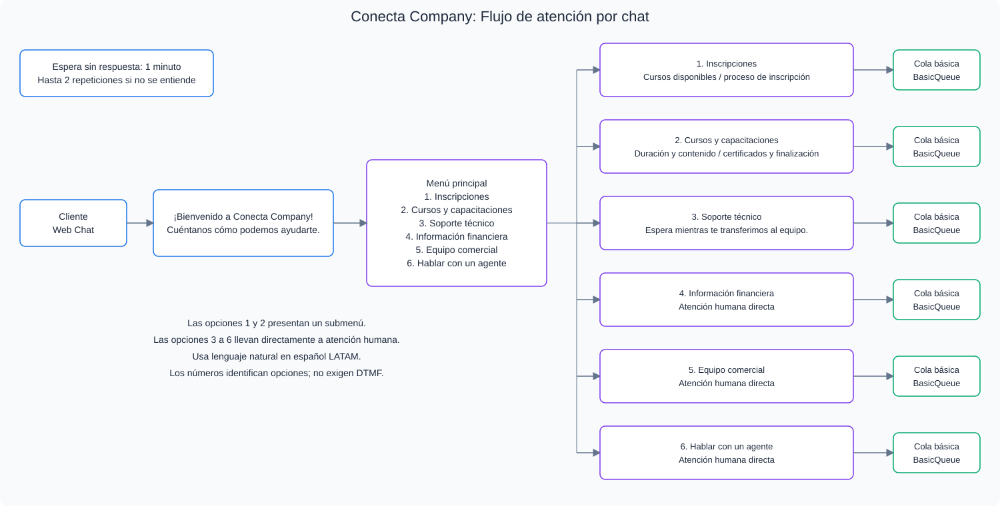

# Módulo 3 — Contact Flow con Amazon Lex V2

[](#-requisitos-de-la-solución)
[](../modulo-02/README.md)

> En este módulo recibirás un requisito de negocio de Conecta Company y deberás diseñar e implementar una solución conversacional con Amazon Lex V2 integrado con Amazon Connect. No hay una receta de implementación. El desafío consiste en entender el problema, investigar los recursos disponibles y decidir cómo construir la solución.

## 🏢 Requisito de negocio

El equipo de atención de Conecta Company definió el comportamiento esperado del canal de chat y entregó el siguiente diagrama:

<div align="center">
  
</div>

> Este es el tipo de documento que un área de negocio suele entregar a un equipo de implementación. Tu tarea es analizar el diagrama, comprender el comportamiento esperado y construir la solución con Amazon Connect y Amazon Lex V2. Los números identifican las opciones del negocio; el cliente debe poder expresarse con lenguaje natural.

## 📋 Qué representa el diagrama

**Entrada y bienvenida**

- El cliente inicia una conversación por Web Chat.
- Se muestra automáticamente un mensaje de bienvenida.

**Menú conversacional principal con seis opciones**

- El cliente expresa lo que necesita y el sistema identifica su intención.
- Opciones: **Inscripciones, Cursos y capacitaciones, Soporte técnico, Información financiera, Equipo comercial, Hablar con un agente**.

**Submenús: Inscripciones y Cursos y capacitaciones**

- Inscripciones presenta un segundo nivel: cursos disponibles y proceso de inscripción.
- Cursos y capacitaciones presenta un segundo nivel: duración/contenido y certificados/finalización.

**Enrutamiento directo**

- Las otras opciones llevan directamente a atención humana, sin submenús.

**Manejo de situaciones inesperadas**

- Maneja la ausencia de respuesta con un **timeout de un minuto**.
- Permite nuevos intentos cuando no se comprende al cliente, con un límite de **dos repeticiones**, sin bucles infinitos.

> La imagen brasileña decía 8 segundos, pero el requisito escrito indicaba un minuto. Esta edición conserva el requisito escrito: **Chat timeout** para interacciones con Lex admite un mínimo de un minuto. No uses un timeout de voz/DTMF para configurar el chat. [Referencia del bloque Get customer input](https://docs.aws.amazon.com/connect/latest/adminguide/get-customer-input.html).

## 🤖 Amazon Lex V2 en este desafío

Necesitarás comprender cómo funciona Amazon Lex V2 y cómo se integra con Connect. Estos conceptos orientan tu investigación; tú decides la implementación.

### Conceptos fundamentales

**Bot**

Es el recurso principal de Amazon Lex V2. Recibe mensajes, procesa el lenguaje natural y decide qué hacer después. En este laboratorio interpreta lo que el cliente escribe en el chat.

**Intent (intención)**

Representa el objetivo del usuario en una conversación. Si alguien escribe “quiero información sobre inscripciones”, Lex identifica la intent correspondiente. Las intents de tu bot deben representar las opciones del menú de Conecta Company.

**Utterances (frases de ejemplo)**

Son distintas formas de expresar una misma intención. Para Inscripciones podrían ser “quiero inscribirme”, “necesito información para registrarme” o “cómo puedo inscribirme”. Usa variantes representativas y diferentes entre intents; la cantidad por sí sola no garantiza precisión.

**Slots**

Son datos específicos que el bot puede recopilar durante la conversación. En este desafío decides si los necesitas y cómo utilizarlos.

**Cómo Connect utiliza Lex**

Connect invoca el bot desde un Contact Flow mediante el bloque **Get customer input**. Al terminar la interacción, recibe la intent identificada y puede decidir el siguiente paso: transferir a una cola, presentar un submenú o finalizar la atención.

📖 [Atributos de sesión Lex + Connect](https://docs.aws.amazon.com/connect/latest/adminguide/how-to-use-session-attributes.html).

### Configuración de idioma para LATAM

- Selecciona **Spanish (Latin America)** en Lex V2: el identificador de locale es **`es_419`**, con guion bajo. En HTML se usa `lang="es-419"`, con guion.
- Escribe las utterances, mensajes de bienvenida, repreguntas y respuestas en español latinoamericano.
- Compila (**Build**) el locale `es_419` y pruébalo antes de integrarlo.
- Para la integración, crea una versión del bot y un alias que apunte a ella; habilita `es_419` en el alias. Si cambias el bot, compila, crea la versión actualizada y ajusta el alias.
- Asocia ese alias a la instancia Connect; para este laboratorio usa la misma región, `us-east-1`.
- Selecciona el idioma/locale correspondiente en la configuración del bloque de interacción cuando la consola lo solicite. No basta con traducir las frases si el alias o la interacción sigue usando otro idioma.

Consulta [idiomas de Lex V2](https://docs.aws.amazon.com/lexv2/latest/dg/how-languages.html) y [la integración con Connect](https://docs.aws.amazon.com/connect/latest/adminguide/amazon-lex.html). Si el editor de bots dentro de Connect no ofrece el locale, crea el bot en la consola de **Amazon Lex V2** y asocia su alias a Connect.

Ejemplos de lenguaje para probar (no son una solución de intents completa):

| Área del menú | Frase del cliente |
|---|---|
| Inscripciones | “Quiero inscribirme” |
| Cursos y capacitaciones | “Quisiera información sobre sus cursos” |
| Soporte técnico | “Necesito ayuda con un problema técnico” |
| Información financiera | “Tengo una consulta sobre un pago” |
| Equipo comercial | “Quiero hablar con el equipo comercial” |
| Hablar con un agente | “Necesito hablar con una persona” |

Ejemplos de mensajes: “¡Bienvenido a Conecta Company! Cuéntanos cómo podemos ayudarte”, “No entendí tu solicitud. ¿Puedes decirlo de otra manera?” y “Te comunicaremos con un agente”. Diseña las frases y el contexto de los submenús para evitar confundir cursos disponibles con duración o contenido.

## 🎯 Requisitos de la solución

**Bot Amazon Lex V2**

- [ ] Crear un bot Lex V2 en español latinoamericano (`es_419`)
- [ ] Crear intents para las opciones del menú principal
- [ ] Crear intents para los submenús de las opciones 1 y 2

**Contact Flow**

- [ ] Mostrar un mensaje de bienvenida al iniciar el chat
- [ ] Usar Lex V2 para identificar la intención del cliente
- [ ] Dirigir el flujo según la intent identificada
- [ ] Implementar la navegación a los submenús de las opciones 1 y 2
- [ ] Enviar las opciones de atención directa a una cola
- [ ] Manejar el timeout de interacción del cliente de un minuto
- [ ] Manejar intents no reconocidas con hasta dos repeticiones
- [ ] Usar al menos una cola de atención
- [ ] Publicar el flujo sin errores de validación
- [ ] Asociarlo al Communication Widget del módulo 2
- [ ] Probar todas las rutas en el simulador disponible y confirmar el comportamiento en el chat del sitio

La cola elegida debe estar en el perfil de enrutamiento del agente con el canal Chat habilitado. Decide cómo conectar las salidas **Timeout**, **Default** y **Error**, y qué ocurrirá al agotar los intentos. La evaluación incluye tu explicación de estas decisiones.

## 📚 Documentación para investigar

> La consola cambia con frecuencia. Si los menús difieren de otros materiales, usa la documentación oficial como referencia principal. No necesitas funciones generativas para resolver el ejercicio.

### Amazon Lex V2

| Tema | Enlace |
|---|---|
| Qué es Lex V2 | [Descripción general](https://docs.aws.amazon.com/lexv2/latest/dg/what-is.html) |
| Crear bots desde Connect | [Creación de bots](https://docs.aws.amazon.com/connect/latest/adminguide/work-bot-building-experience.html) |
| Agregar intents | [Intents](https://docs.aws.amazon.com/lexv2/latest/dg/add-intents.html) |
| Configurar utterances | [Frases de ejemplo](https://docs.aws.amazon.com/lexv2/latest/dg/sample-utterances.html) |
| Probar el bot en la consola | [Pruebas](https://docs.aws.amazon.com/lexv2/latest/dg/test-bot.html) |
| Buenas prácticas | [Recomendaciones](https://docs.aws.amazon.com/lexv2/latest/dg/guidelines.html) |

### Integración Amazon Connect + Amazon Lex V2

| Tema | Enlace |
|---|---|
| Agregar el bot a Connect | [Integración](https://docs.aws.amazon.com/connect/latest/adminguide/amazon-lex.html) |
| Crear un flujo conversacional | [Flujo con bot](https://docs.aws.amazon.com/connect/latest/adminguide/create-bot-flow.html) |
| Atributos de sesión | [Session attributes](https://docs.aws.amazon.com/connect/latest/adminguide/how-to-use-session-attributes.html) |
| Catálogo completo de bloques | [Bloques de flujo](https://docs.aws.amazon.com/connect/latest/adminguide/contact-block-definitions.html) |
| Buenas prácticas para flujos | [Recomendaciones](https://docs.aws.amazon.com/connect/latest/adminguide/bp-contact-flows.html) |
| Enrutamiento y colas | [Configurar colas](https://docs.aws.amazon.com/connect/latest/adminguide/connect-queues.html) |
| Logs en CloudWatch | [Habilitar logs](https://docs.aws.amazon.com/connect/latest/adminguide/contact-flow-logs.html) |

## 📝 Registra tus decisiones

Parte de la evaluación consiste en explicar lo que construiste. Mientras trabajas, anota:

- Qué intents creaste y por qué elegiste esa estructura.
- Qué utterances utilizaste y cómo las definiste.
- Cómo el Contact Flow utiliza la intent devuelta por Lex para decidir.
- Cómo representaste los submenús mediante intents y flujo.
- Cómo manejaste el timeout y las intents no reconocidas.
- Qué cambiarías si la empresa tuviera más áreas de atención.

Estas respuestas forman parte de la plantilla de entrega del módulo 4.

## 📌 Registra el Contact Flow ID

Después de publicar, consulta el ID en los datos del flujo o en su URL. El formato de la consola puede variar; copia el ID real, no el alias de la instancia ni un ID de ejemplo.

```text
Contact Flow ID: ________________________________
```

## ✅ Criterios de éxito

- El bot Lex V2 tiene intents para todas las opciones del menú.
- Las utterances cubren variantes representativas en español LATAM.
- El bot responde correctamente en la prueba de Lex antes de integrarlo.
- El alias con locale `es_419` está integrado con Connect.
- El Contact Flow usa la intent devuelta por Lex para decidir el enrutamiento.
- Los submenús funcionan con sus propias intents.
- El timeout y los errores de reconocimiento no bloquean la atención.
- El flujo se publica sin errores.
- Se verifican todas las rutas con las herramientas de prueba disponibles y el chat real.
- El flujo está asociado al Communication Widget.

## 📚 Documentación de referencia — módulo 3

Las tablas de investigación anteriores reúnen las referencias de este módulo. Para revisar específicamente los errores y timeouts, consulta [Get customer input](https://docs.aws.amazon.com/connect/latest/adminguide/get-customer-input.html); para el idioma, consulta [locales de Lex V2](https://docs.aws.amazon.com/lexv2/latest/dg/how-languages.html).

## 🚨 Problemas comunes

**El bot no reconoce la intención**
→ Revisa las utterances y el locale. Agrega variantes pertinentes y vuelve a compilar. Actualiza la versión del alias usado por Connect. [Frases de ejemplo](https://docs.aws.amazon.com/lexv2/latest/dg/sample-utterances.html).

**Connect no encuentra el bot**
→ Comprueba región, versión, alias, locale habilitado y asociación a la instancia. [Integración](https://docs.aws.amazon.com/connect/latest/adminguide/amazon-lex.html).

**El flujo no decide correctamente según la intent**
→ Revisa los nombres exactos y las salidas de **Get customer input**. [Flujo con bot](https://docs.aws.amazon.com/connect/latest/adminguide/create-bot-flow.html).

**El flujo no se publica**
→ Revisa conexiones y configuración de todos los bloques, incluidas las rutas de error. [Buenas prácticas](https://docs.aws.amazon.com/connect/latest/adminguide/bp-contact-flows.html).

¿Otros problemas? Consulta la [guía de solución de problemas](../../troubleshooting.md).

**¿Terminaste el módulo 3? Continúa con el [módulo 4 →](../modulo-04/README.md)**
